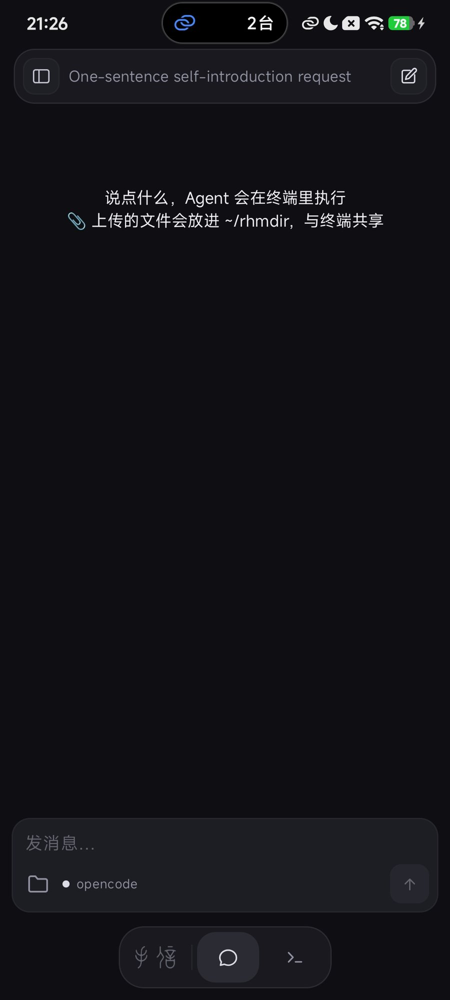
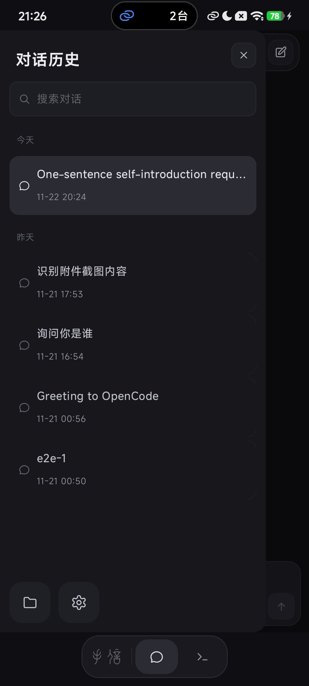
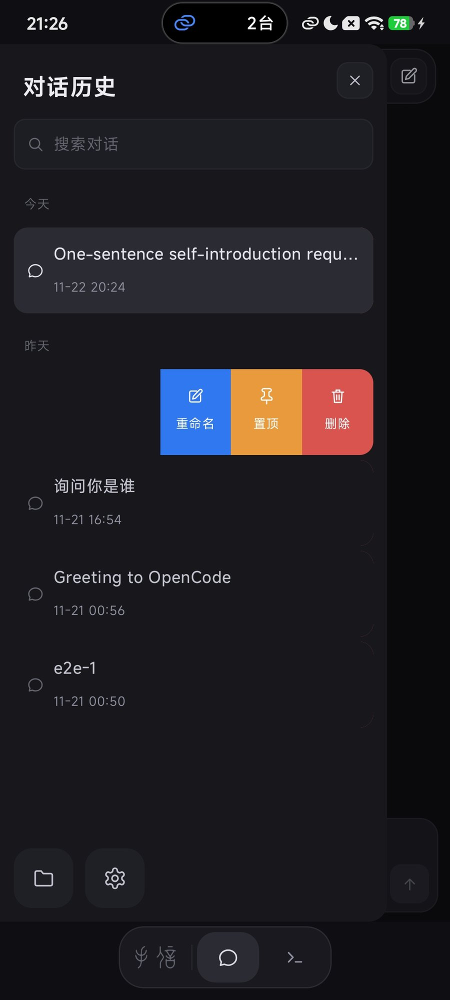
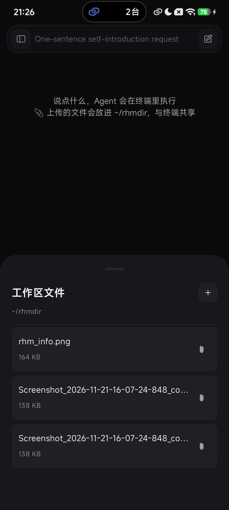
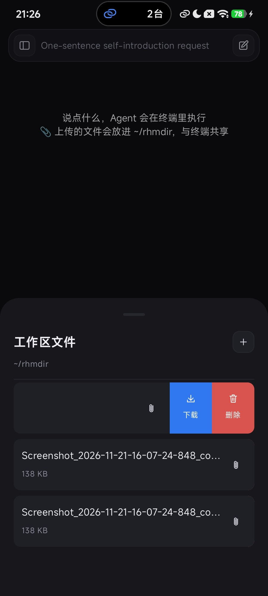
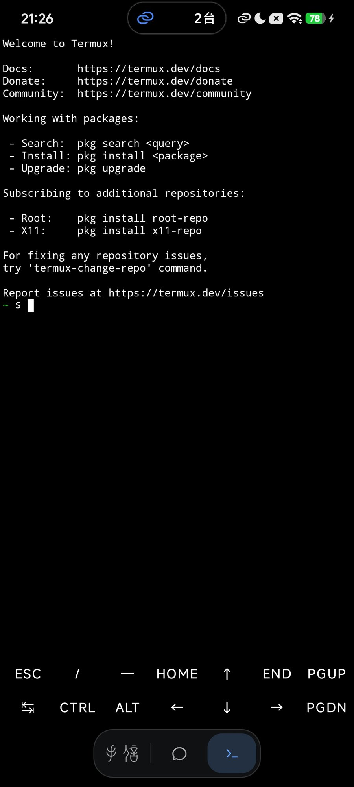
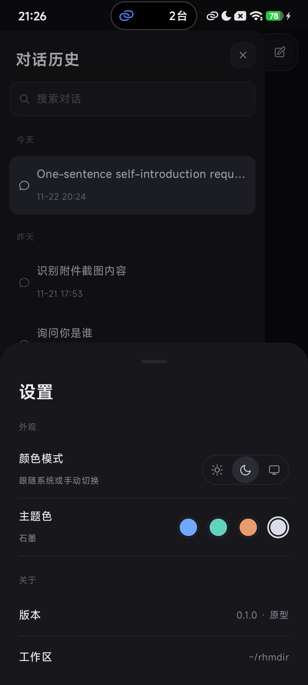
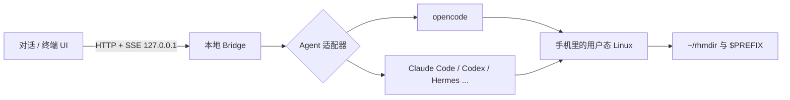
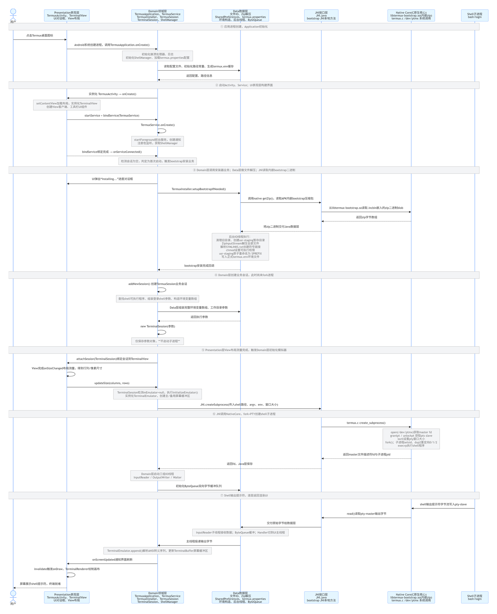

# 手信 · RightHandMan

> 把手机变成一台随身的 Linux 与 AI 助手工作站。

[](COPYING)


手信是一个基于 [Termux](https://termux.dev) 的 Android 应用：一个「对话」tab，一个「终端」tab，两者共享同一套手机本地的 Linux 环境与 `~/rhmdir` 工作区。对话由本地 Bridge 转成 Agent 命令，在手机里执行；不需要 root，也没有作者的中转服务器。

## 为什么是手信

大多数人一天里用得最久的电脑，其实是手机。

可我们还是在为“云端的一台电脑”续费：订阅、积分、额度，还有那句熟悉的“额度用完了，明天再试试”。

手信换个思路：**让手机自己成为那台电脑。**

- **不需要 root。** Termux 在 Android 用户态里跑一套可用的 Linux 环境，手信在它上面加了一间“对话 + 终端”的门面。
- **不需要云电脑。** 文件、命令、会话默认都在本机；模型调用按你选择的服务商计费，没有第二份“远端主机”租金。
- **不需要先把资料交出去。** Bridge 只监听 `127.0.0.1`，作者没有中转服务器；使用云端模型时，只有你交给 Agent 的对话和它读取的文件内容会发给你选择的模型服务。
- **不需要被一个 Agent 绑死。** 默认接 `opencode`，也可以直接换成 Claude Code、Codex、Hermes 等——在手机终端里装好就能跑。
- **不需要先成为 Linux 高手。** 打开对话就能用；想自己动手，切到终端，`pkg` / `apt` / 你的脚本都在同一个环境里。

一句话：**你需要的不是一个更便宜的云电脑，而是一台一直在你口袋里的 Linux。**

## 界面预览

以下均为小米 12 / Android 15 实机截图（深色主题），会话与文件名均为测试数据。

<table>
  <tr>
    <td align="center"><br><sub>对话：说人话，Agent 在终端里执行</sub></td>
    <td align="center"><br><sub>历史会话：按时间分组、可搜索</sub></td>
    <td align="center"><br><sub>会话操作：重命名 / 置顶 / 删除</sub></td>
  </tr>
  <tr>
    <td align="center"><br><sub>工作区：对话与终端共享 ~/rhmdir</sub></td>
    <td align="center"><br><sub>文件操作：引用 / 下载 / 删除</sub></td>
    <td align="center"><br><sub>终端：完整 Termux，页面常驻黑色</sub></td>
  </tr>
  <tr>
    <td align="center"><br><sub>设置：明暗模式与主题色</sub></td>
    <td></td>
    <td></td>
  </tr>
</table>

## 它能做什么

在对话里说人话，Agent 在手机本地执行：

- 整理资料：把文件放进 `~/rhmdir`，让它读取、归纳、改名、归档；
- 写网页 / 脚本：生成、运行、报错、再改，循环都在手机里完成；
- 文档草稿：生成 Markdown / HTML / 代码，再交给本机上的编辑或转换工具；
- 处理媒体：用 `ffmpeg` / ImageMagick 批量转码、截帧、压缩；
- 跑服务与运维：`apt` / `pkg`、Python、Node、本地端口；
- 需要确认时随时切到终端，看它到底在做什么。

能力上限取决于你接的 Agent 和模型；它不是魔法，重要任务仍然需要人复核。

## 数据与隐私

- 会话、文件、终端与命令执行默认都在手机上；
- Bridge 仅监听 `127.0.0.1`，本项目没有作者的中转服务器；
- 用云端模型时，你发送的对话和 Agent 读取的文件内容会发给你选择的模型服务；想完全本地化，可以接 Ollama 等本地模型；
- Agent 拥有你的用户权限，**不要把它当安全沙箱**；重要文件先备份，敏感数据自行判断。

## 快速开始

> 当前为开发者预览。安装包见 [Releases](https://github.com/zlllw/right-hand-man/releases)（预览包使用 debug 签名）；也可以按下方步骤自行构建。

1. 安装 APK，首次打开等待运行环境准备（自动安装 python / node / npm，需要联网）；
2. 按 `opencode` 的方式配置模型服务：API Key，或本地 Ollama；
3. 在「对话」里输入任务；底部切换到「终端」就是完整的 Termux；
4. 上传或引用文件时，它会落到 `~/rhmdir`，对话和终端共用；
5. 想换 Agent：Claude Code、Codex、Hermes 等可以直接在终端里安装运行（已实测）；对话页默认使用 `opencode`，其他 Agent 可通过 Bridge 适配器接入（适配器在 `bridge/adapters/`）。

`opencode` 支持多家模型服务，是否有免费额度、额度多少，以你选择的服务商为准，本项目不做承诺。

## 工作原理



- 底层是 Termux 的用户态 Linux（无需 root），JNI 与终端仿真负责把本地 shell 和 Android 连起来；
- 手信本身是壳：Compose 的对话 / 终端界面 + 本地 Bridge + Agent 适配器；
- 对话和终端共享同一份 `$PREFIX`、`$HOME` 和 `~/rhmdir`，不是两套环境。

### Termux 启动与终端创建时序

下面是上游 Termux 的完整启动链路：从点击图标、初始化 Application / Service、解压 bootstrap，到创建 PTY 并驱动 `TerminalView`。手信通过共享的终端宿主复用同一条链路。



## 当前状态

- 开发者预览，功能和界面仍在快速变化；
- 对话页默认 Agent 是 `opencode`；Claude Code / Codex / Hermes 等已在 Termux 环境验证可直接运行；
- Android 12+ 对后台进程限制较严，长时间任务可能被系统回收；
- 不是 Termux 官方项目，遇到 Termux 本身的问题请优先查上游文档。

**适合**：想把手机当随身 Linux、已经有 API Key 或本地 Ollama、愿意折腾的人。

**不适合**：需要稳定商用、完全零配置、没有 Android 设备的人。

## 从源码构建

### 环境

- JDK 21
- Android SDK（compileSdk 36）
- Android NDK `29.0.14206865`（Gradle 可自动下载）
- Gradle 9.2.1（仓库自带 wrapper）

```bash
git clone git@github.com:zlllw/right-hand-man.git
cd right-hand-man
export ANDROID_HOME=/path/to/Android/Sdk

./gradlew assembleDebug
./gradlew :app:testDebugUnitTest
```

Windows 中文路径会导致 Gradle / NDK 的 classpath 乱码，可先映射盘符再构建：

```bat
subst P: "D:\path\to\right-hand-man"
```

产物在 `app/build/outputs/apk/debug/`，按 ABI 分包（arm64-v8a 对应真机）。

### Bridge（桌面验证）

Bridge 只用 Python 标准库：

```bash
python bridge/server.py --port 8765 --adapter fake
python -m unittest discover -s bridge/tests
```

### 真机测试

```bash
ANDROID_SERIAL=<设备序列号> ./gradlew :app:connectedDebugAndroidTest
```

MIUI 可能需要在应用信息里允许「后台弹出界面」，并保持屏幕解锁。

### 实验性的 Go Bridge

`feat/go-bridge` 分支有一份零依赖的 Go 重写（协议对齐、36 项契约测试、四 ABI 交叉编译）：

```bash
git checkout feat/go-bridge
cd bridge-go && go test ./... && ./build-android.sh
```

## 项目结构

| 路径 | 作用 |
|---|---|
| `app/` | Compose 双入口 UI、终端宿主、Bridge 进程管理 |
| `bridge/` | 本地 HTTP/SSE Bridge（Python 标准库）与 Agent 适配器 |
| `bridge-go/` | Go 重写（`feat/go-bridge` 分支） |
| `terminal-view/`、`terminal-emulator/` | Termux 终端渲染与模拟器（Apache-2.0） |
| `termux-shared/` | Termux 共享库（MIT / GPLv3 混合，见其 LICENSE） |
| `scripts/` | bootstrap 改写、图标生成等脚本 |
| `site/` | UI / 图标设计原型（HTML） |
| `tests/fixtures/` | 跨语言 SSE fixture |

## 开源协议

手信是 Termux 的派生项目，**整体沿用上游的 GPLv3 only**，新增代码同样以 GPLv3 only 发布：

- 完整协议文本：[`COPYING`](COPYING)（GNU GPL v3）；
- 上游协议说明：[`LICENSE.md`](LICENSE.md)；
- `terminal-view`、`terminal-emulator`：Apache-2.0（与 GPLv3 兼容）；
- `termux-shared`：默认 MIT，`com.termux.shared.termux/*` 为 GPLv3 only，个别文件另有例外，详见 [`termux-shared/LICENSE.md`](termux-shared/LICENSE.md)。

如果你**分发**修改后的 APK，需要按 GPLv3 同时提供对应源码；只是自己使用、不对外分发，不受开源义务约束。

## 致谢与商标

- [Termux](https://termux.dev) 及其贡献者：没有 Termux 就没有手信；
- [Android Terminal Emulator](https://github.com/jackpal/Android-Terminal-Emulator)（Apache-2.0）；
- [opencode](https://opencode.ai) 以及所有上游依赖的作者。

Termux 是 Termux 项目的名称；本项目是非官方 fork。opencode、Claude、Codex、Hermes 等名称归各自所有者，提及不代表背书。